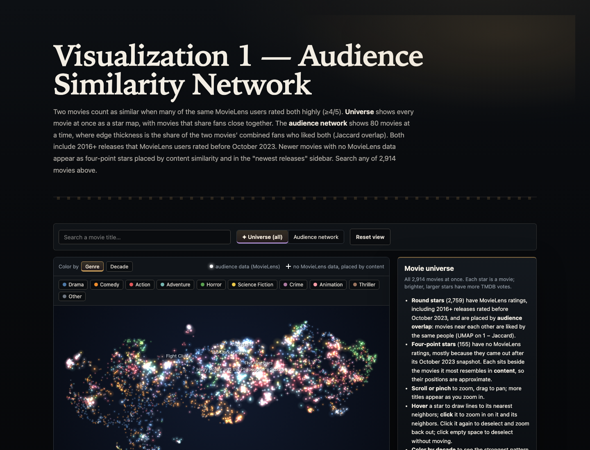
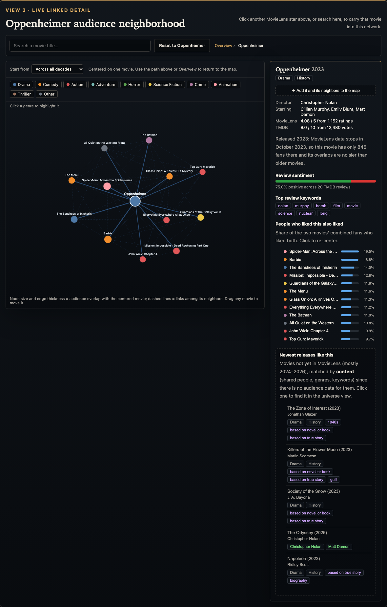
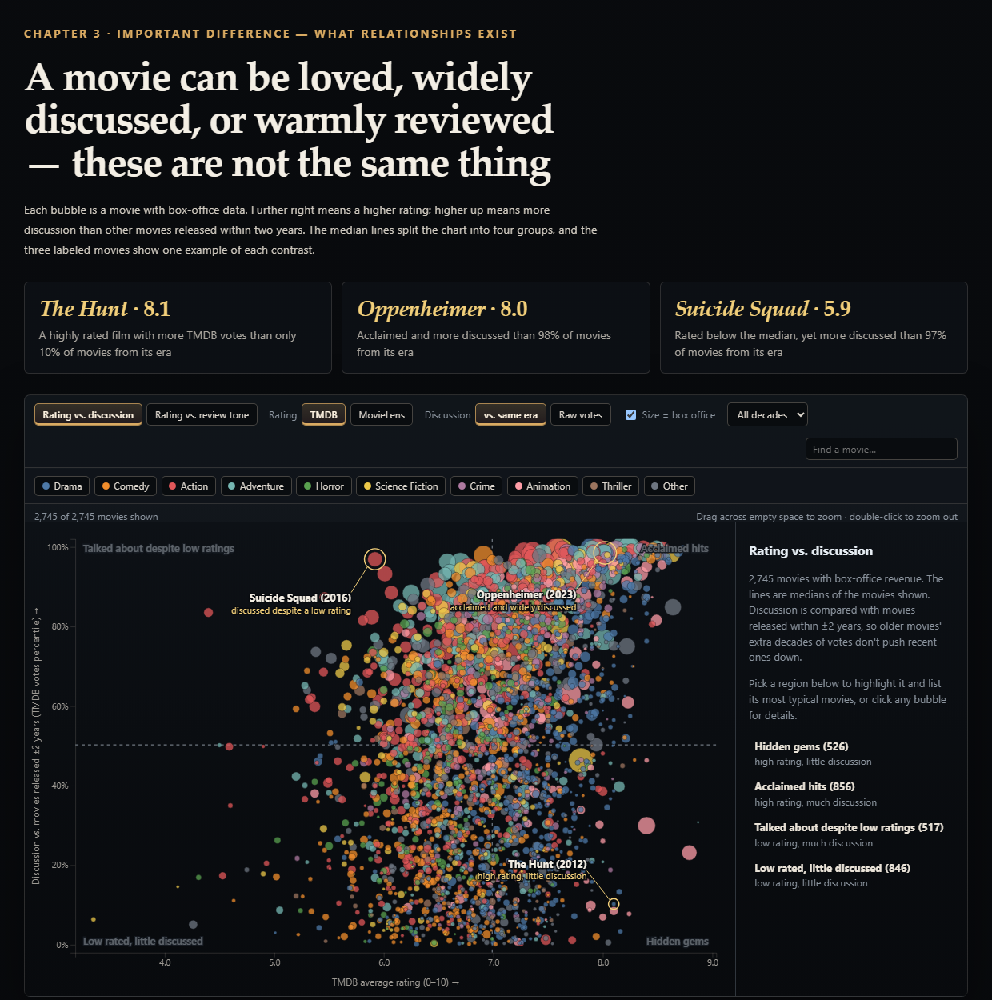
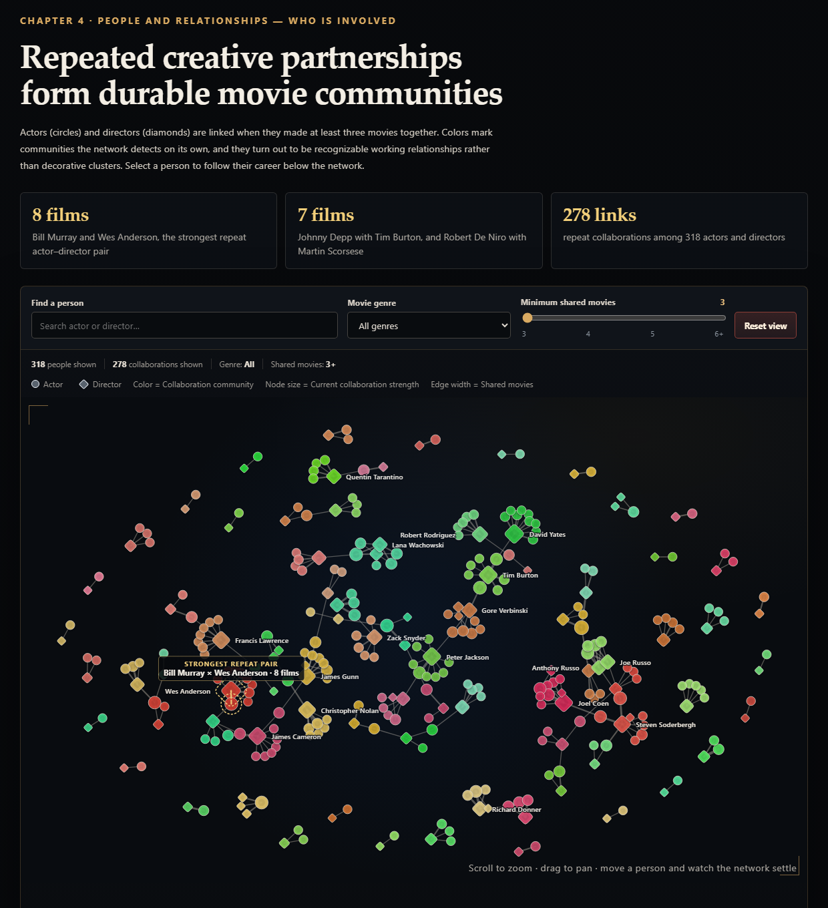
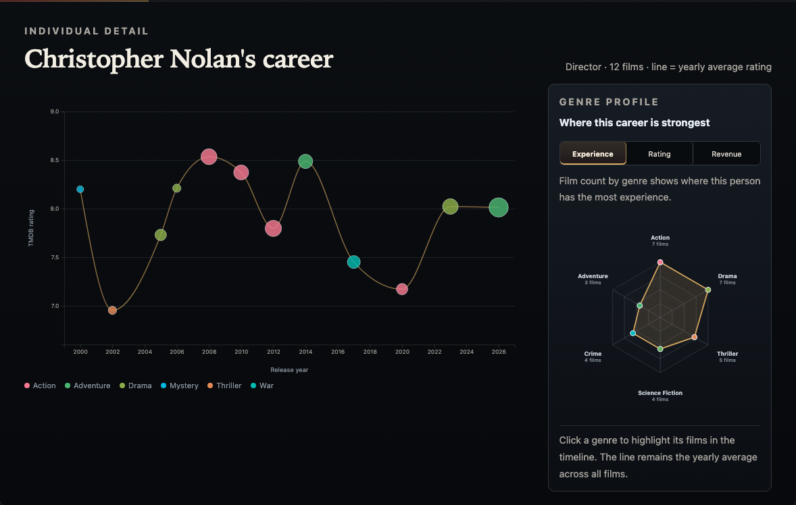
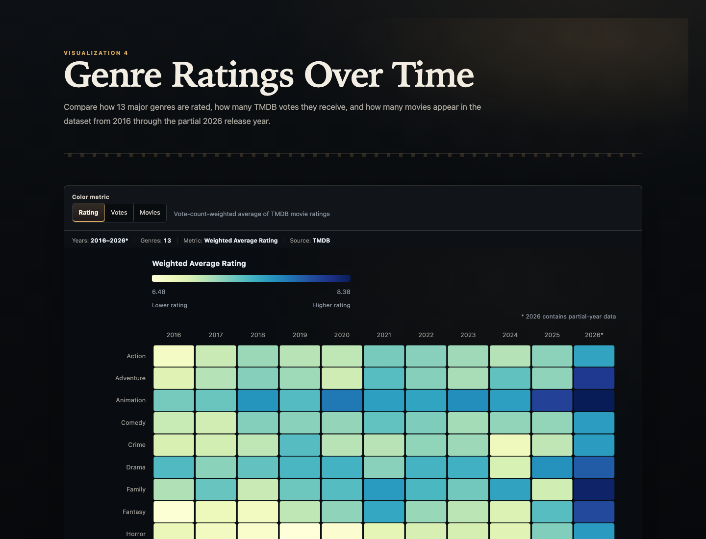

# WatchNext: Understanding Movies Beyond a Single Rating

## Executive Summary

WatchNext is an interactive movie-exploration website built around a simple problem: a single rating cannot explain why a movie matters or what someone should watch next. A rating describes one form of evaluation, but it does not show whether a movie attracted unusually high attention, appealed to the same viewers as another title, received a similar tone in written reviews, or belonged to a durable creative partnership. Our project therefore combines five coordinated visualization views into four research topics: genre change over time, audience similarity, rating versus attention and review tone, and actor–director collaboration with individual career detail.

The project combines MovieLens 32M with movie metadata, cast and director credits, financial attributes, keywords, and reviews collected from the TMDB API. After cleaning, matching, filtering, and deduplication, the processed dataset contains 2,914 movies. The visual evidence shows that movie reception is multidimensional. Across the complete years 2016–2025, Animation has the highest vote-count-weighted TMDB rating at 7.47, while Action receives about 2.05 million votes despite a lower weighted rating of 6.98. Audience-similar movies are strongly structured by era and genre: 77.1% of stored neighbors share a release decade and 90.0% share at least one genre. The scatterplot further shows that high rating, high voting attention, and positive written-review tone are related but not interchangeable. Finally, the collaboration network reveals recurring creative communities, while the linked Career Timeline and Genre Profile show how an actor's or director's work varies across time, genre experience, audience reception, and reported commercial scale.

Instead of generating one opaque recommendation, WatchNext gives viewers a transparent path for discovery. A viewer can start with a familiar movie, see where it sits among audience neighbors, inspect what those shared viewers also like, compare whether a title is acclaimed or simply widely discussed, and then follow the creative people behind it. The website uses *Oppenheimer* as a recurring example so that these forms of evidence remain connected across the story.

## Introduction

### Project motivation and context

Movie websites often reduce a title to a rating, genre, cast list, and popularity score. These values are useful for lookup, but they separate information that viewers normally combine when deciding what to watch. A rating does not explain whether a movie attracted a large audience, whether its written reviews agree with its score, whether it appeals to the same viewers as another movie, or whether it emerged from a recurring creative partnership. Conventional ranked lists also hide the fact that a movie can be highly rated but lightly discussed, widely discussed but poorly rated, or similar to another title for audience reasons that are not captured by genre alone.

WatchNext addresses this gap through an interactive website built around one central question: **What makes audiences love a movie, and if they love one movie, what else might they love?** The project does not treat “love” as one perfect metric. Instead, it separates genre-level reception, audience overlap, ratings, voting attention, written-review tone, collaboration history, and career patterns so viewers can compare several kinds of evidence before forming an interpretation.

### Research questions

1. **How do genre reception and audience voting activity change over time?**
2. **Which movies attract similar audiences? If viewers like one movie, what other movies are they likely to enjoy?**
3. **How do ratings differ from audience attention and written-review tone?**
4. **Which actor–director partnerships recur, and what do individual career timelines reveal about genre experience, audience reception, and commercial scale?**

The final question deliberately combines a network-level question with an individual-detail question. The collaboration network identifies repeated partnerships and communities; the Career Timeline and Genre Profile then help viewers examine where a selected actor's or director's work is concentrated and how those films performed. These measures can suggest areas of experience, audience acceptance, and commercial value, but they do not directly measure acting or directing skill.

### Intended audience

The intended audience is general moviegoers who want to discover films and understand why recommendations or reputations form. The website also supports students and casual analysts who want to compare movie data without reading a large table or reproducing the processing pipeline. The interface assumes curiosity rather than statistical expertise: users can start with a known movie or person, follow visible connections, and obtain exact values through tooltips and detail panels.

### Why these questions matter

These questions matter because movie discovery is both comparative and relational. Viewers do not only ask whether one movie has a good score; they ask how it compares with its time period, what else similar viewers enjoyed, whether its reputation is supported by attention and reviews, and which creative histories may shape its style. Visualization is appropriate because these questions involve temporal patterns, spatial neighborhoods, multivariate comparisons, and networks that are difficult to understand from a table or a single ranking. Five interactive views let users move from overview to detail while retaining the context needed to interpret each result.

## Method

### Data sources and acquisition

The project combines **MovieLens 32M** with data collected from the **TMDB API**. MovieLens contains 32,000,204 ratings and 2,000,072 tags from 200,948 users across 87,585 movies. TMDB provides genres, release dates, ratings, vote counts, budget, revenue, cast, directors, keywords, and available written reviews. The historical track began with high-rating-count MovieLens titles matched to TMDB IDs. A second track was collected directly from TMDB to improve recent coverage because MovieLens ends in October 2023 and becomes thinner for newer releases. After duplicate TMDB IDs were removed, the processed dataset contained 2,914 movies: 1,998 historical titles and 916 recent titles.

### Cleaning, transformation, and analysis

We parsed release years and genres, normalized external IDs, validated MovieLens ratings, removed duplicate user–movie pairs, and treated zero or clearly unrealistic budget and revenue values as missing. We collected each movie's top billed cast, directors, keywords, and reviews from TMDB. In total, 11,481 reviews covering 2,648 movies were cleaned and deduplicated. Review sentiment was estimated with `siebert/sentiment-roberta-large-english`, and review keywords were extracted with TF–IDF.

Visualization-specific transformations were created in Python. Audience similarity uses Jaccard overlap between users who rated both movies at least 4 out of 5; UMAP places those distances in the Movie Universe. Discussion is measured as TMDB vote-count percentile among movies released within ±2 years. Collaboration strength counts shared actor–director films, and network communities are detected from the collaboration structure. Genre–year ratings are weighted by each movie's TMDB vote count. Exported JSON files keep browser loading focused and reproducible.

### Visualization technologies and implementation

The data pipeline uses Python, pandas, NumPy, scikit-learn, UMAP, NetworkX, Transformers, and TF–IDF. The website uses HTML, CSS, JavaScript, and D3.js. Canvas supports the dense Movie Universe, while SVG supports the scatterplot, networks, heatmap, axes, and transitions. Shared styling creates a consistent cinematic interface. Search, filters, tooltips, zooming, dragging, selection, reset behavior, and responsive layouts were tested in the browser.

## Results

The final website contains **five visualization views** organized into four connected story topics. The Movie Universe and Audience Network are separate views but work together as Visualization 1 on the website: the first provides an overview and the second provides details for one selected movie. The homepage presents the heatmap first to establish context, then follows *Oppenheimer* through audience, response, and collaboration views.

**Jump to a view:** [Movie Universe](#visualization-1-movie-universe) · [Audience Network](#visualization-2-audience-network) · [Scatterplot](#visualization-3-performance-and-discussion-scatterplot) · [Collaboration Network](#visualization-4-actordirector-collaboration-network) · [Genre Heatmap](#visualization-5-genre-ratings-heatmap)

### Visualization 1: Movie Universe

**Question addressed.** This overview begins Question 2: which movies attract similar audiences, and what broader structure do those relationships form?

**What and goal.** The Movie Universe places all 2,914 movies as stars. The 2,759 movies with MovieLens data are positioned by audience overlap; 155 newer movies without audience data use content-based placement and a four-point shape. The view asks where a movie belongs among titles liked by similar audiences.

**Interactions and finding.** Users can search, hover, zoom, pan, click a movie, and switch color between genre and decade. The layout reveals that audience neighborhoods are shaped by both era and genre: 77.1% of stored neighbors share a release decade and 90.0% share at least one genre. A ring marks the eight *Harry Potter* films as one recognizable neighborhood.

[Open the Movie Universe →](https://blackcatyu.github.io/WatchNext/viz1.html)

### Visualization 2: Audience Network

**Question addressed.** This detail view completes Question 2: if viewers like one selected movie, what other movies are they likely to enjoy?

**What and goal.** The Audience Network turns the universe overview into details for one selected movie. Links represent audience overlap between movies, while side panels explain shared genres, people, keywords, and content-based suggestions for recent titles. It addresses the question: what else do viewers of this movie also like?

**Interactions and finding.** Users can search for a title, recenter the network, drag nodes, highlight a genre, inspect exact similarity values, and move between connected movies. Across 33,108 stored neighbor relationships, 36.8% share the same primary genre compared with 12.2% of all movie pairs. The result shows that audience similarity adds evidence beyond a simple genre label while still reflecting genre and release era.

[Open the Oppenheimer Audience Network →](https://blackcatyu.github.io/WatchNext/viz1.html#movie=287699)

**How the views connect.** A viewer selects a MovieLens title in the Movie Universe, carries that movie into the Audience Network, and then reads its shared-fan links alongside ratings, reviews, keywords, and related titles. Clicking a neighboring movie recenters the detail view and continues the exploration.

### Visualization 3: Performance and Discussion Scatterplot

**Question addressed.** This view answers Question 3: how do ratings differ from audience attention and written-review tone?

**What and goal.** Each bubble represents a movie with box-office data. The default view compares rating with discussion relative to movies released within ±2 years; a second view compares rating with positive written-review tone. Bubble size represents revenue and color represents primary genre. The goal is to distinguish acclaim, attention, and written response.

**Interactions and finding.** Users can search, filter by genre or decade, switch rating sources, select a quadrant, brush to zoom, and open movie details. *The Hunt* is rated 8.1 but has more votes than only 10% of movies from its era. *Oppenheimer* is rated 8.0 and is more discussed than 98%, while *Suicide Squad* is rated 5.9 but is more discussed than 97%. High ratings and high attention are therefore not equivalent.

[Open the Performance and Discussion Scatterplot →](https://blackcatyu.github.io/WatchNext/viz2.html)

### Visualization 4: Actor–Director Collaboration Network

**Question addressed.** This linked overview and detail answer Question 4: which actor–director partnerships recur, and what do individual careers reveal about genre experience, audience reception, and commercial scale?

**What and goal.** This network contains 318 actors and directors connected by 278 repeat-collaboration links. Circles are actors, diamonds are directors, node size is current collaboration strength, edge width is shared movies, and color is a detected collaboration community. Selecting a person opens a Career Timeline and linked Genre Profile comparing experience, audience reception, and commercial scale.

**Interactions and finding.** Users can search, filter by the genres of shared movies, change the minimum collaboration threshold, zoom, pan, drag individual nodes, select a collaborator, and reset the view. In the detail view, they can switch between Experience, Rating, and Revenue, then click a genre to highlight its films in the timeline. This helps viewers understand the span of an actor's or director's career and identify genres in which their work is more frequent, better received, or commercially larger. These measures can support discussion of likely strengths and commercial value, but they do not directly measure acting or directing skill. Bill Murray and Wes Anderson form the strongest displayed pair with eight shared films; Johnny Depp–Tim Burton and Robert De Niro–Martin Scorsese each share seven.

[Open the Collaboration Network →](https://blackcatyu.github.io/WatchNext/viz3.html)

**How the views connect.** Clicking a circle or diamond focuses direct collaborators and opens the selected person's Career Timeline. The Genre Profile then summarizes their six most frequent genres by film count, vote-count-weighted TMDB rating, or median reported revenue. Clicking a genre links the summary back to the individual films.

### Visualization 5: Genre Ratings Heatmap

**Question addressed.** This view answers Question 1: how do genre reception and audience voting activity change from 2016 through the partial 2026 data?

**What and goal.** The heatmap compares 13 major genres across 2016–2026. Rows are genres, columns are years, and color can represent vote-count-weighted rating, total vote count, or number of movies. It asks how the story changes when acclaim, voting activity, or dataset coverage becomes the metric.

**Interactions and finding.** Hovering highlights a genre row and year column and shows all three measures. Clicking a cell opens the movies behind its value, while metric changes update the legend and leading-genre annotation with a short transition. Across complete years 2016–2025, Animation has the highest weighted rating at 7.47, while Action has about 2.05 million votes despite a 6.98 rating. The 2026 column is explicitly marked as partial-year data.

[Open the Genre Ratings Heatmap →](https://blackcatyu.github.io/WatchNext/viz4.html)

## Discussion

### What–Why–How evaluation

**What.** WatchNext combines quantitative attributes—ratings, votes, revenue, years, similarity, and collaboration counts—with categorical attributes such as genre, role, and community. It also uses review text through sentiment and keywords. **Why.** The main tasks are to locate a known item, discover related items, compare groups, identify outliers, inspect trends, and move from overview to detail. **How.** Position shows similarity or quantitative value; color distinguishes genre, decade, community, or heatmap magnitude; size represents votes, revenue, or collaboration strength; shape separates data coverage and actor/director roles; links represent audience or collaboration relationships. Search, filtering, selection, zoom, drag, and animated transitions support exploration without permanently adding labels.

### Strengths and interaction effectiveness

The strongest design decision is that each interaction serves a specific question. Search supports known-item lookup, filters make comparisons, zooming reveals dense regions, and selection opens exact details. The Universe and Audience Network create a clear overview-to-detail sequence, while the collaboration network and career view connect structure with time. Finding-style headlines, evidence cards, on-chart annotations, and a recurring *Oppenheimer* example make important results visible before interaction. Consistent typography, controls, dark cinematic styling, and restrained animation make five views feel like one project.

### Weaknesses, limitations, and improvements

The dataset favors popular titles with many MovieLens ratings or TMDB votes. MovieLens ends in October 2023, so the newest movies use content placement rather than equivalent audience overlap. TMDB vote count measures activity on one platform, not total popularity. Review samples are small for many films, sentiment may misread dark subject matter, and missing revenue excludes many streaming-first releases from the scatterplot. The collaboration network also focuses only on people with at least five movies and pairs with at least three shared films.

Dense views still require effort on small screens, and the five views do not share a persistent selection. The homepage guides users through *Oppenheimer*, but it does not automatically carry that selection between charts. Future work should add cross-view state, improve mobile detail panels, compare alternative similarity thresholds, and conduct a formal task-based user study. Current browser testing covers loading, search, filters, metric switching, selection consistency, reset, zoom, drag, tooltips, responsive layout, and console errors, but it does not replace evaluation with representative users.

## Conclusion

### Answer to Question 1: Genre reception changes differently from voting activity

Genre reception does change over time, but the leading genre depends on what “reception” means. Across the complete years 2016–2025, Animation has the highest vote-count-weighted TMDB rating at 7.47, whereas Action attracts about 2.05 million votes with a weighted rating of 6.98. The heatmap therefore shows that stronger average evaluation and greater audience voting activity are not the same outcome. Switching to movie count also reveals how much of an apparent trend may reflect dataset coverage rather than audience preference. The partial 2026 column must be interpreted separately because it does not represent a complete year.

### Answer to Question 2: Similar audiences create neighborhoods shaped by era and genre

Movies that attract similar audiences are not distributed randomly. Among 33,108 stored neighbor relationships, 77.1% connect movies from the same release decade and 90.0% share at least one genre. The Movie Universe makes this larger structure visible, while the Audience Network turns it into a practical next-movie path: beginning with one title, viewers can inspect the movies with the strongest shared-fan overlap and then compare their genres, people, ratings, reviews, and keywords. The system does not claim that every neighbor is a guaranteed recommendation, but it provides transparent evidence for why another movie may be relevant.

### Answer to Question 3: Rating, attention, and review tone describe different responses

The scatterplot shows that a high rating does not guarantee high attention, and high attention does not guarantee a high rating. *The Hunt* is rated 8.1 but has more votes than only 10% of movies released around the same time. *Oppenheimer* is rated 8.0 and is more discussed than 98% of its era, while *Suicide Squad* is rated 5.9 yet is more discussed than 97%. Switching to written-review tone adds another distinction: a numerical score and the language used in available reviews can disagree because they come from different samples and summarize different behaviors.

### Answer to Question 4: Repeated partnerships form communities, while career detail adds context

The collaboration network identifies stable creative relationships rather than isolated credits. Bill Murray and Wes Anderson form the strongest displayed pair with eight shared movies; Johnny Depp–Tim Burton and Robert De Niro–Martin Scorsese each share seven. Community structure shows that repeated partnerships connect larger groups of actors and directors. Selecting one person then changes the question from “who works together?” to “how has this person's work developed?” The Career Timeline shows career span, release rhythm, ratings, primary genres, and reported revenue, while the Genre Profile compares experience, vote-count-weighted audience reception, and median reported commercial scale across frequent genres. These measures help viewers discuss likely areas of strength and commercial value, but they do not directly measure acting or directing ability.

### What the complete project contributes

WatchNext shows that movie reception is multidimensional and that no single ranking can answer all four questions. For viewers, the complete visualization provides a transparent discovery process rather than one automatic recommendation. A user can begin with a familiar movie, inspect its audience neighborhood, compare whether related titles are acclaimed or simply widely discussed, examine the tone of written reviews, and follow the people behind the film into collaboration and career detail. This process contributes to knowledge generation by making the reasoning behind discovery visible: the audience can see which evidence supports a possible next movie, where that evidence agrees, and where it conflicts or remains incomplete.

The project also demonstrates why coordinated views are more informative than a larger single chart. The heatmap establishes genre context, the Movie Universe and Audience Network explain similarity at two scales, the scatterplot separates different forms of response, and the collaboration and career views reveal creative structure over time. Together they help audiences make more informed viewing choices and communicate not only whether they like a movie, but why it stands out and how it connects to other movies and filmmakers.

## Team Contributions

**Jiaxuan** was responsible for collecting and processing TMDB data, including metadata, cast, directors, keywords, and reviews. Jiaxuan recalculated the Genre Heatmap using vote-count-weighted TMDB ratings and produced its genre-by-year aggregates. Jiaxuan developed the Collaboration Network and Genre Heatmap with their filtering, animation, linked detail, timeline, and genre-profile interactions. Jiaxuan also designed and polished the website's overall layout and visual style and created the editable A1 poster.

**Muyu** built the data pipeline, collecting and cleaning MovieLens and TMDB data and merging them into the final 2,914-movie dataset. Muyu also scored review sentiment, extracted review keywords, and computed the MovieLens audience similarity used in the Movie Universe and Audience Network. Muyu developed the visualization of Movie Universe, Audience Network, and Performance and Discussion Scatterplot with their search, including the Movie Universe, Audience Network, and performance/discussion scatterplot with their search, filtering, selection, and detail interactions. Muyu built the homepage story and its on-chart annotations.

Both team members contributed to project framing, integration, debugging, interpretation, documentation, and presentation preparation.

## References

- GroupLens Research. *MovieLens 32M Dataset*. https://grouplens.org/datasets/movielens/32m/
- The Movie Database. *TMDB API Documentation*. https://developer.themoviedb.org/docs/getting-started
- SiEBERT. *Sentiment RoBERTa Large English*. https://huggingface.co/siebert/sentiment-roberta-large-english
